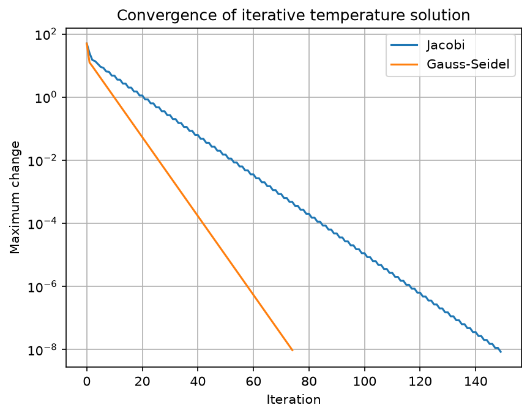
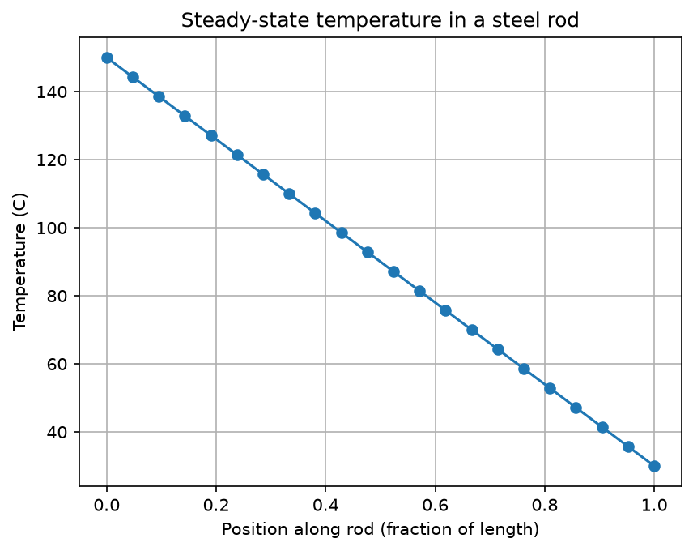

# Task 8 – Iterative Methods for Linear Systems

Programs: [`code/Task_08_iterative_linear.py`](../code/Task_08_iterative_linear.py) · [`extensions/Task_08_ext_heated_rod.py`](../extensions/Task_08_ext_heated_rod.py)

## B. Inputs and mathematical operations

| Item | Value |
|---|---|
| Inputs | 5 × 5 tridiagonal matrix (2 on the diagonal, −1 beside it); b = [100, 0, 0, 0, 20] (boundary temperatures 100 °C and 20 °C); start x = 0; tolerance 10⁻⁸; max 500 iterations |
| Operations | **Jacobi:** xᵢ⁽ᵏ⁺¹⁾ = (bᵢ − Σⱼ≠ᵢ aᵢⱼ xⱼ⁽ᵏ⁾)/aᵢᵢ using only old values. **Gauss-Seidel:** same but uses newly updated values immediately. Stop when max\|change\| < tolerance. |

Each row says: temperature at a grid point is the average of its neighbours (steady heat flow).

## C. Changing an input

Grid size and tolerance were changed (boundaries 100 °C / 20 °C):

| Points n | Tolerance | Jacobi iterations | Gauss-Seidel iterations |
|---|---|---|---|
| 5 | 1e-8 | 150 | 75 |
| 5 | 1e-3 | 70 | 35 |
| 20 | 1e-8 | 1672 | 842 |
| 40 | 1e-8 | 5935 | 2993 |
| 40 | 1e-3 | 2017 | 1034 |

**Explanation:** a looser tolerance stops earlier (fewer iterations) but gives a less accurate answer. More grid points make convergence much slower (roughly ∝ n²) – which is why real 2-D/3-D simulations use better iterative methods. Gauss-Seidel needs about **half** as many iterations as Jacobi every time.

## D. Meaning of the output and graph

```
Jacobi temperatures:       [86.667 73.333 60.0 46.667 33.333]
Gauss-Seidel temperatures: [86.667 73.333 60.0 46.667 33.333]
Direct solution:           [86.667 73.333 60.0 46.667 33.333]
Jacobi iterations: 150     Gauss-Seidel iterations: 75
```

The temperature falls evenly by 13.33 °C per grid point between the 100 °C hot end and the 20 °C cold end – the expected straight-line profile for steady conduction. Both iterative answers agree with the direct solver to about 10⁻⁸.



The graph plots the largest change per iteration on a logarithmic axis. Both curves are straight lines, i.e. the error shrinks by a constant factor each step (**linear convergence**). The Gauss-Seidel line is about twice as steep, so it reaches 10⁻⁸ in half as many iterations.

## E. Different real-world case – steady heat conduction in a steel rod

* **Assumptions:** 1-D rod, no heat loss from the sides, constant conductivity, ends held at 150 °C and 30 °C, 20 interior grid points.
* **Output:**
  ```
  Gauss-Seidel converged in 860 iterations; max error vs direct = 4.39e-07 C
  temperature at midpoint: 87.14 C (linear profile -> expected 87.14 C)
  ```
* **Interpretation:** the temperature falls linearly along the rod (see `figures/ext_task_08_rod_profile.png`); the midpoint is about 87 °C. The heat flux is uniform along the rod. The same method scales to thousands of unknowns in 2-D plates where a direct solver would need far more memory.


