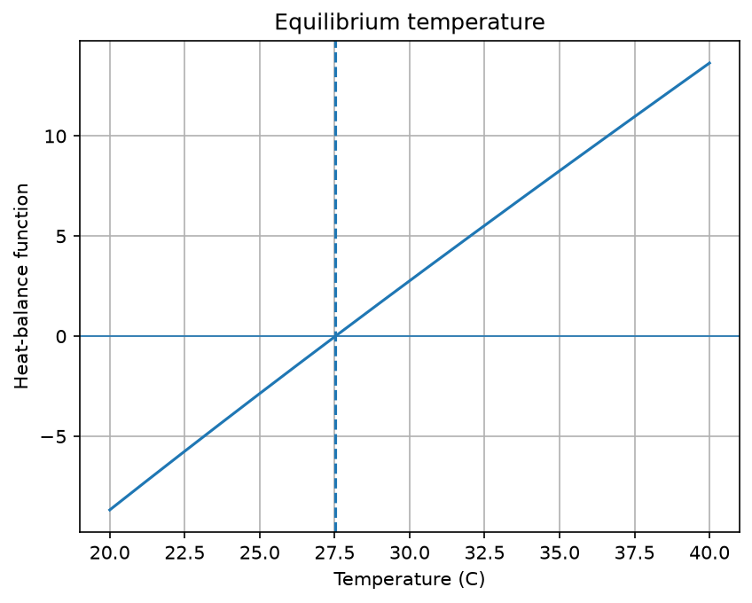
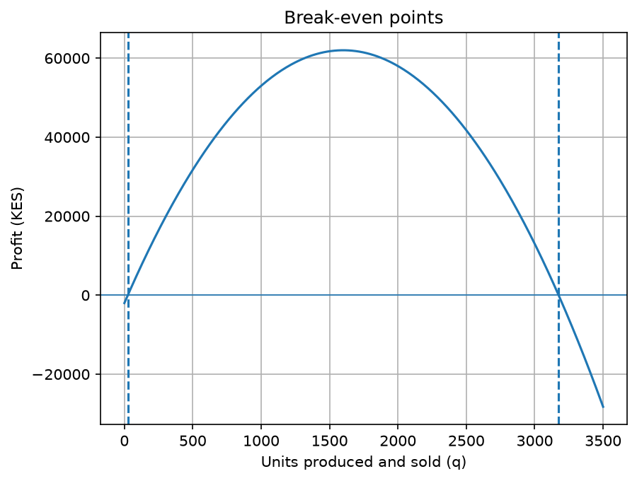

# Task 10 – Root Finding: Bisection and Fixed-Point Methods

Programs: [`code/Task_10_bisection_fixed_point.py`](../code/Task_10_bisection_fixed_point.py) · [`extensions/Task_10_ext_break_even.py`](../extensions/Task_10_ext_break_even.py)

## B. Inputs and mathematical operations

| Item | Value |
|---|---|
| Function | f(T) = T − 25 − 10·e^(−T/20) (heat gain = heat loss when f = 0) |
| Inputs | bracket [20, 40] with f(20) < 0 < f(40); tolerance 10⁻¹⁰; for fixed point: start T₀ = 30 and g(T) = 25 + 10·e^(−T/20) |
| Operations | **Bisection:** halve the interval and keep the half where the sign changes. **Fixed-point iteration:** Tₙ₊₁ = g(Tₙ) until \|Tₙ₊₁ − Tₙ\| < 10⁻¹⁰ |

## C. Changing an input

* **Ambient constant 25 → 30 °C:** the equilibrium moves from 27.5252 °C to 32.0172 °C – a hotter surrounding raises the balance temperature (by slightly less than 5 °C because of the exponential term).
* **Tolerance:** 10⁻² → 10 halvings; 10⁻⁶ → 24; 10⁻¹⁰ → 37. Each extra decimal digit costs about 3.3 more halvings.

## D. Meaning of the output and graph

```
Bisection equilibrium temperature: 27.525211 C
Bisection iterations: 38
Fixed-point equilibrium temperature: 27.525211 C
Fixed-point iterations: 13
```

Both methods find the same equilibrium temperature, 27.5252 °C – the temperature at which heat gain equals heat loss. Bisection is guaranteed to work if the sign changes but halves the error only once per step (38 steps here); fixed-point iteration converged in 13 steps because |g′(T)| = 0.5·e^(−T/20) ≈ 0.13 < 1 near the root, so each step reduces the error by ≈ 87 %. If |g′| were > 1 the iteration would diverge.



The curve crosses the horizontal axis (f = 0) exactly once between 20 and 40 °C; the dashed vertical line marks the root. To the left f < 0 (heat loss exceeds gain – temperature would rise), to the right f > 0.

## E. Different real-world case – break-even points of a business

* **Assumptions:** price falls as volume rises, p = 100 − 0.02 q (KES/unit); cost = 2000 + 20 q + 0.005 q². Profit(q) = revenue − cost = −0.025 q² + 80 q − 2000. Break-even: Profit = 0.
* **Method:** my own bisection function (and SciPy as a check) on two brackets, because a downward parabola crosses zero twice.
* **Output:**
  ```
  lower break-even q = 25.20 units (27 halvings; SciPy 25.20)
  upper break-even q = 3174.80 units (31 halvings)
  maximum at q = 1600, profit = 62,000 KES
  ```
* **Interpretation:** the firm loses money if it sells fewer than ≈ 26 units (fixed cost not recovered) or more than ≈ 3,175 units (falling price and rising unit cost). It is profitable in between, with maximum profit of 62,000 KES at 1,600 units.


