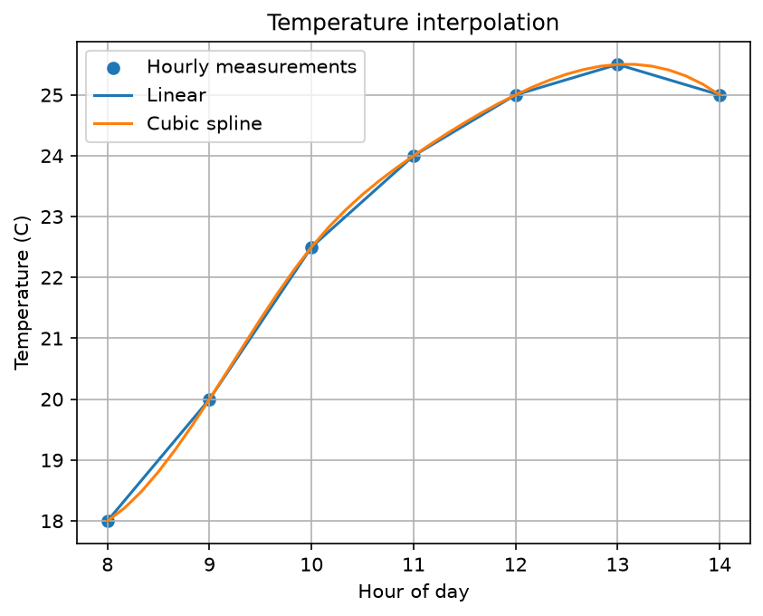
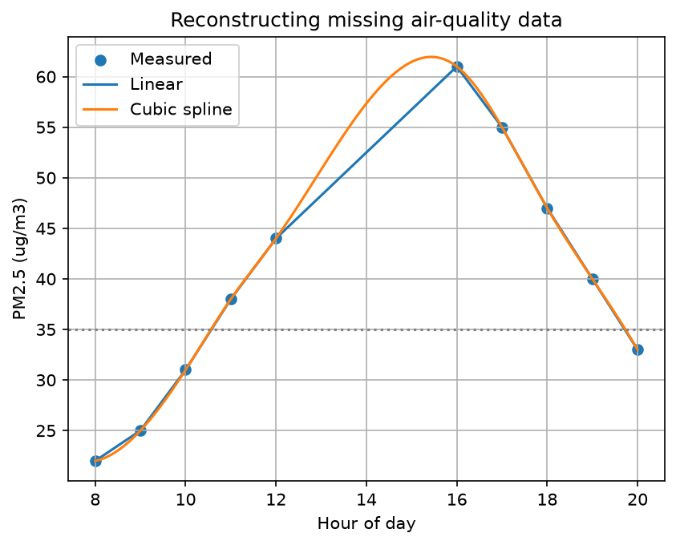

# Task 13 – Interpolation

Programs: [`code/Task_13_interpolation.py`](../code/Task_13_interpolation.py) · [`extensions/Task_13_ext_missing_data.py`](../extensions/Task_13_ext_missing_data.py)

## B. Inputs and mathematical operations

| Item | Value |
|---|---|
| Inputs | hours 8…14 and temperatures [18, 20, 22.5, 24, 25, 25.5, 25] °C; evaluation times every 10 minutes (37 points) |
| Operations | **linear** (`interp1d`): straight line between neighbouring points; **cubic spline** (`CubicSpline`): piecewise cubic polynomials with continuous value, slope and curvature at the data points |

## C. Changing an input

The 12:00 measurement was changed from 25.0 to 29.0 °C:

| Method | Estimate at 10:30 (25.0 at 12:00) | Estimate at 10:30 (29.0 at 12:00) |
|---|---|---|
| Linear | 23.25 | 23.25 |
| Quadratic | 23.36 | 22.96 |
| Cubic spline | 23.36 | 22.87 |

**Explanation:** linear interpolation is *local* – only the two neighbouring measurements (10:00 and 11:00) matter, so changing 12:00 has no effect. Spline interpolation is *global*: the smoothness conditions link all the points, so a change at 12:00 slightly changes the curve (and the estimate) at 10:30.

## D. Meaning of the output and graph

```
Linear estimate at 10:30: 23.25 C
Cubic estimate at 10:30:  23.36 C
```

At 10:30 the temperature is estimated at about 23.3 °C (halfway between 22.5 °C and 24 °C is 23.25 °C; the spline bends slightly above it because the temperature curve is concave there).



Both curves pass exactly through the dots (the measurements). The linear estimate is a polyline with corners at every hour; the cubic spline is smooth and shows the temperature levelling off and peaking just after 13:00 – more realistic for a physical quantity. The difference between the two methods (≈ 0.1 °C) gives a feel for the *uncertainty* of the interpolated values.

## E. Different real-world case – filling missing air-quality data

* **Assumptions:** a PM2.5 sensor logs hourly (µg/m³) from 08:00 to 20:00 but lost power at 13:00, 14:00 and 15:00; pollution changes smoothly (no sudden events during the gap).
* **Input data:** [22, 25, 31, 38, 44, **–, –, –**, 61, 55, 47, 40, 33].
* **Output:**
  ```
  hour   linear    cubic
    13     48.2     50.8
    14     52.5     57.3
    15     56.8     61.5
  hours above 35 ug/m3 over 08:00-20:00 (cubic estimate): 9.2 h
  ```
* **Interpretation:** the missing hours are estimated at roughly 48–62 µg/m³, all above the 35 µg/m³ "unhealthy for sensitive groups" level; the cubic estimate is higher than the linear one because it follows the rising trend. The reconstructed series suggests about 9 hours above the limit. **Caution:** interpolation cannot recover a real peak that occurred *inside* the gap, so the estimates should be flagged as estimates.


