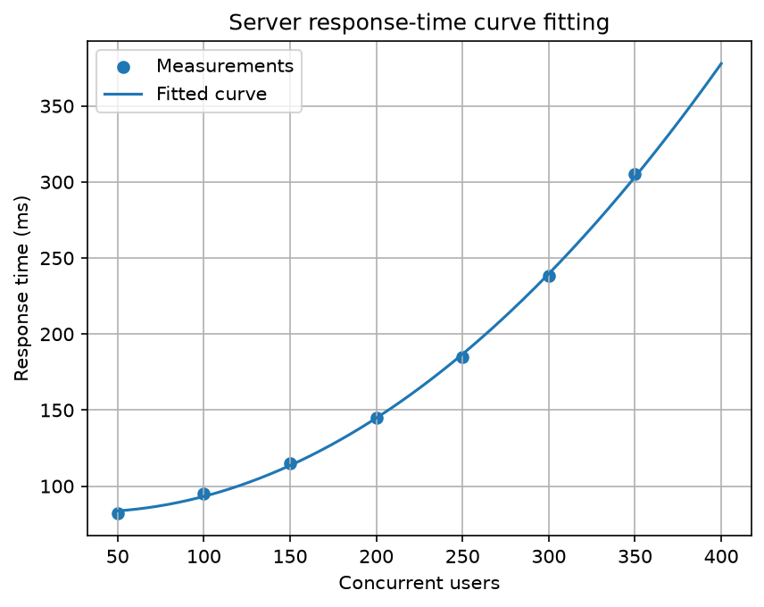
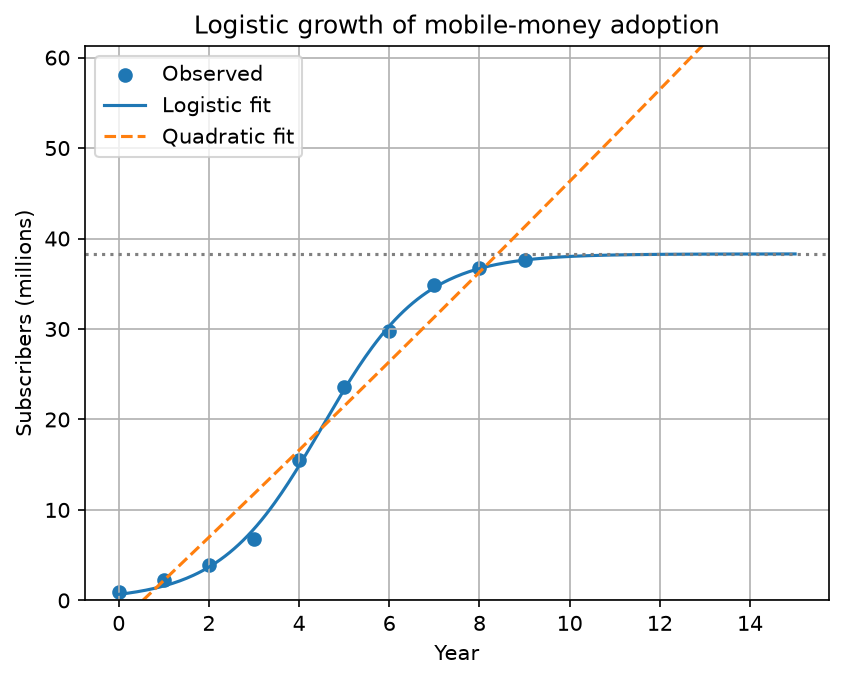

# Task 14 – Curve Fitting and Approximation

Programs: [`code/Task_14_curve_fitting.py`](../code/Task_14_curve_fitting.py) · [`extensions/Task_14_ext_logistic_growth.py`](../extensions/Task_14_ext_logistic_growth.py)

## B. Inputs and mathematical operations

| Item | Value |
|---|---|
| Inputs | concurrent users [50, 100, …, 350] and response times [82, 95, 115, 145, 185, 238, 305] ms |
| Model | y = a·x² + b·x + c (quadratic) |
| Operations | `curve_fit` chooses a, b, c minimising the **sum of squared residuals** Σ(yᵢ − ŷᵢ)²; RMSE = √(mean(residual²)); prediction at 400 users |

## C. Changing an input

The model (polynomial degree) was changed:

| Degree | RMSE | Prediction at 400 users |
|---|---|---|
| 1 (line) | 18.83 ms | 312.9 ms |
| 2 (quadratic) | 1.55 ms | 377.9 ms |
| 3 (cubic) | 0.14 ms | 387.9 ms |

**Explanation:** a straight line cannot follow the bending data (large RMSE). More parameters always reduce the error on the data, but a cubic has 4 parameters for only 7 points and may be **over-fitting** noise, which makes extrapolated predictions unreliable. The choice of model should be guided by understanding of the system, not by the smallest RMSE alone.

## D. Meaning of the output and graph

```
Fitted model: y = 0.002167x^2 + -0.1345x + 85.00
RMSE: 1.55 ms
Predicted response at 400 users: 377.86 ms
```

The fitted curve says the baseline response time is ≈ 85 ms and that delay grows faster than linearly with load (positive x² term). On average the model is off by only 1.55 ms from the measurements. The prediction for 400 users (≈ 378 ms) is an **extrapolation** beyond the measured range (≤ 350), so it is less trustworthy than a prediction inside the range.



The dots (measurements) lie almost on the fitted curve; the curve rises slowly at first and steeply at high load, showing the server approaching saturation.

## E. Different real-world case – logistic growth of mobile-money subscribers

* **Assumptions:** subscriber numbers (millions) over 10 years follow an S-shaped curve y = K / (1 + e^(−r(t − t₀))) with saturation K; measurements have random noise (synthetic data, seed 1; true values K = 38, r = 0.9, t₀ = 4.5).
* **Output:**
  ```
  carrying capacity K = 38.3 +/- 0.5 million subscribers
  growth rate r = 0.894/yr, midpoint t0 = 4.51 years, RMSE = 0.51
  forecast year 10: 38.0 million   year 12: 38.3   year 15: 38.3
  quadratic would forecast 72.0 million in year 15 (unrealistic: no ceiling)
  ```
* **Interpretation:** the fit recovers the true parameters closely (K ≈ 38.3 million with a standard error of 0.5; the adoption speed peaks at year 4.5). The market saturates at about 38 million. A quadratic fits the past data but would forecast 72 million in year 15 – a nonsensical forecast – showing why the model's *shape* must match the real process.


