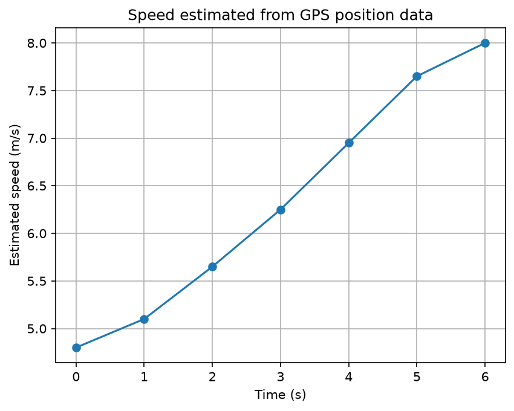

# Task 15 – Numerical Differentiation

Programs: [`code/Task_15_numerical_differentiation.py`](../code/Task_15_numerical_differentiation.py) · [`extensions/Task_15_ext_acceleration.py`](../extensions/Task_15_ext_acceleration.py)

## B. Inputs and mathematical operations

| Item | Value |
|---|---|
| Inputs | GPS times 0…6 s (1 s apart) and positions [0, 4.8, 10.2, 16.1, 22.7, 30.0, 38.0] m |
| Operations | speed = dx/dt estimated by **forward difference** (first point) (x₁ − x₀)/h, **central difference** (interior points) (xᵢ₊₁ − xᵢ₋₁)/(2h), **backward difference** (last point) (xₙ − xₙ₋₁)/h |

## C. Changing an input

The step size h was changed when differentiating sin(x) at x = 1 (true derivative cos 1 = 0.5403):

| h | Forward error | Central error |
|---|---|---|
| 1 | 4.7 × 10⁻¹ | 8.6 × 10⁻² |
| 0.1 | 4.3 × 10⁻² | 9.0 × 10⁻⁴ |
| 0.01 | 4.2 × 10⁻³ | 9.0 × 10⁻⁶ |
| 10⁻⁴ | 4.2 × 10⁻⁵ | 9.0 × 10⁻¹⁰ |
| 10⁻⁸ | 3.0 × 10⁻⁹ | 2.6 × 10⁻⁹ |
| 10⁻¹² | 4.3 × 10⁻⁵ | 1.2 × 10⁻⁵ |

**Explanation:** forward difference has error ∝ h (first order) and central difference ∝ h² (second order), so central is far more accurate for the same h. But when h becomes extremely small, subtracting nearly equal numbers causes round-off error (Task 4) and the error grows again. There is an optimal h (≈ 10⁻⁸ for forward, ≈ 10⁻⁵ for central).

## D. Meaning of the output and graph

```
t=0s, position=0.0m,  estimated speed=4.80m/s
t=1s, position=4.8m,  estimated speed=5.10m/s
t=2s, position=10.2m, estimated speed=5.65m/s
t=3s, position=16.1m, estimated speed=6.25m/s
t=4s, position=22.7m, estimated speed=6.95m/s
t=5s, position=30.0m, estimated speed=7.65m/s
t=6s, position=38.0m, estimated speed=8.00m/s
```

The vehicle speeds up steadily from about 4.8 m/s (17 km/h) to 8.0 m/s (29 km/h) over six seconds, i.e. an average acceleration of about 0.5 m/s² ((8.0 − 4.8)/6 s), rising to ≈ 0.7 m/s² in the middle of the run. The end points use one-sided differences, which are less accurate than the central differences in the interior.



The speed curve rises monotonically; it is steepest between 3 and 5 s and flattens at the end partly because the final value is a less accurate backward difference.

## E. Different real-world case – bus telematics: acceleration from speed

* **Assumptions:** a bus logs its speed every 2 s; harsh braking is deceleration stronger than 1.5 m/s²; NumPy's `np.gradient` uses central differences inside and one-sided differences at the ends.
* **Output (selected):**
  ```
  t=   0s  v=  0.0 m/s  a= +1.50 m/s^2
  t=   4s  v=  7.5 m/s  a= +2.00 m/s^2
  t=  14s  v=  9.0 m/s  a= -2.45 m/s^2
  t=  16s  v=  4.0 m/s  a= -2.00 m/s^2
  harsh braking at t = [14.0, 16.0] s;  peak deceleration -2.45 m/s^2
  ```
* **Interpretation:** the bus accelerates for 10 s, cruises at ≈ 14 m/s (50 km/h) and then brakes hard between 12 and 18 s – the fleet manager can flag this trip for driver feedback. Because the samples are 2 s apart, short braking spikes are averaged out; faster logging would be needed to catch them.
