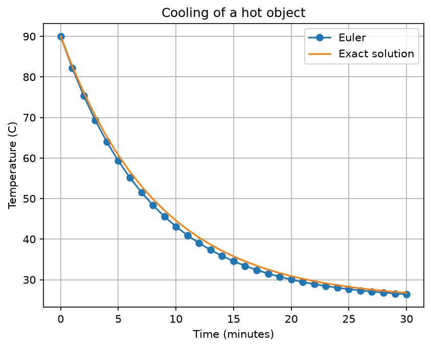
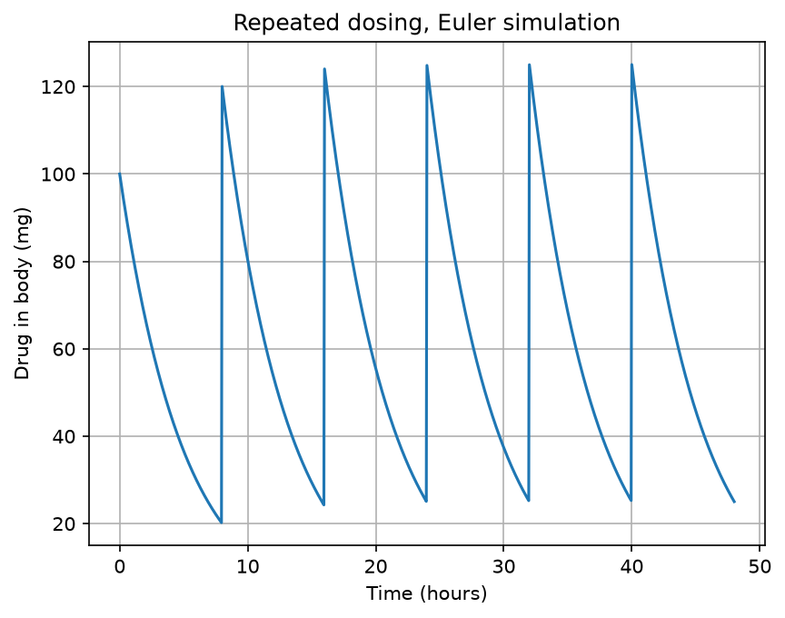

# Task 17 – Ordinary Differential Equations: Euler Method

Programs: [`code/Task_17_euler_ode.py`](../code/Task_17_euler_ode.py) · [`extensions/Task_17_ext_drug_dosing.py`](../extensions/Task_17_ext_drug_dosing.py)

## B. Inputs and mathematical operations

| Item | Value |
|---|---|
| ODE | Newton's law of cooling dT/dt = −k (T − T_ambient) |
| Inputs | T_ambient = 25 °C, T(0) = 90 °C, k = 0.12 /min, step h = 1 min, end time 30 min |
| Operations | Euler update Tₙ₊₁ = Tₙ + h·(−k (Tₙ − T_ambient)); compared with the exact solution T(t) = T_amb + (T₀ − T_amb)·e^(−kt) |

## C. Changing an input

Step size h (error at t = 30 min; exact value 26.776 °C):

| h (min) | Euler result | Absolute error |
|---|---|---|
| 4 | 25.668 | 1.1078 |
| 1 | 26.404 | 0.3720 |
| 0.5 | 26.587 | 0.1890 |
| 0.1 | 26.738 | 0.0383 |
| 0.01 | 26.772 | 0.0038 |

**Explanation:** halving h roughly halves the error (Euler is a first-order method), at the cost of twice as many steps. There is also a stability limit: with h = 20 min (> 2/k ≈ 16.7) the solution oscillates and blows up (−66 → 152 → −153 °C), which is physically impossible.

## D. Meaning of the output and graph

```
Euler temperature after 30 min: 26.40 C
Exact temperature after 30 min: 26.78 C
Final absolute error: 0.3720 C
```

After 30 minutes the object has cooled from 90 °C to about 26.4 °C, nearly the room temperature of 25 °C. Euler is 0.37 °C too low because each step uses the rate at the *start* of the step, which is the largest for the step, so it over-cools slightly.



Both curves fall steeply at first (large temperature difference → fast cooling) and flatten as they approach 25 °C (exponential decay). The Euler markers lie just below the exact line, showing the small accumulated error.

## E. Different real-world case – drug concentration with repeated doses

* **Assumptions:** one-compartment model, the drug is eliminated at a rate proportional to the amount in the body dA/dt = −k A with k = 0.2 /h (half-life ≈ 3.5 h); 100 mg is taken immediately at t = 0 and then every 8 hours; Euler step h = 0.05 h.
* **Output:**
  ```
  amount in body just after dose at 8 h : 120.0 mg
  amount just after dose at 40 h        : 125.0 mg
  theoretical steady-state peak         : 125.3 mg
  trough just before a dose at 40 h     : 25.3 mg
  half-life = ln2/k = 3.47 h
  ```
* **Interpretation:** the drug accumulates for the first few doses (100 → 120 → … mg) and then settles into a repeating cycle between ≈ 25 mg (trough) and ≈ 125 mg (peak). The simulation matches the steady-state theory peak 100/(1 − e^(−kτ)) = 125.3 mg. A doctor can use it to check that the peak stays below a toxic level and the trough above the effective level.


