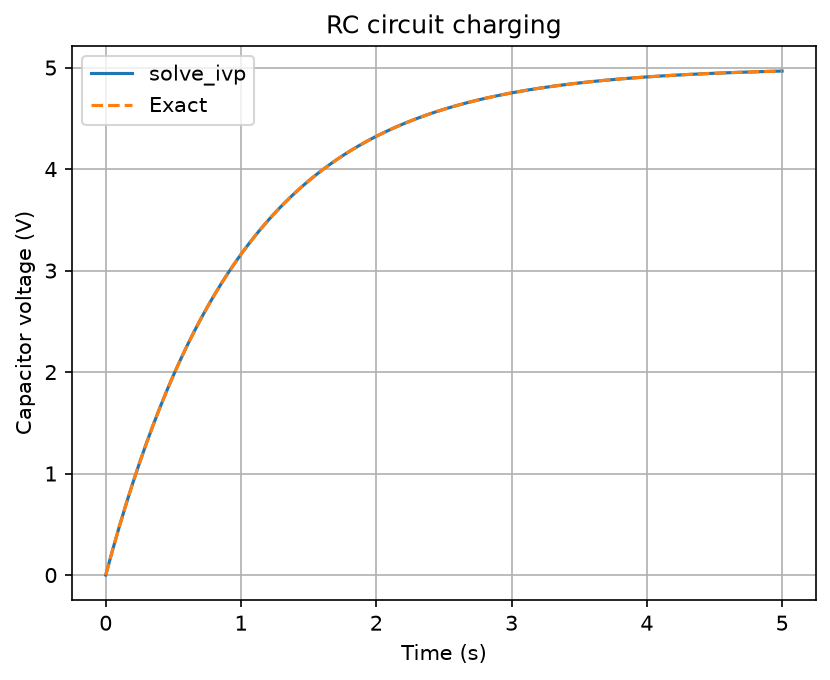
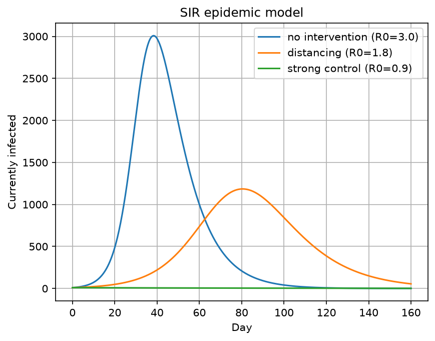

# Task 18 – Numerical Solution of ODEs Using SciPy

Programs: [`code/Task_18_scipy_ode.py`](../code/Task_18_scipy_ode.py) · [`extensions/Task_18_ext_sir_epidemic.py`](../extensions/Task_18_ext_sir_epidemic.py)

## B. Inputs and mathematical operations

| Item | Value |
|---|---|
| ODE | RC charging circuit dV/dt = (Vs − V)/(R·C) |
| Inputs | Vs = 5 V, R = 1000 Ω, C = 0.001 F (time constant τ = RC = 1 s), V(0) = 0 V, time 0–5 s (200 output points), tolerances rtol = 10⁻⁹, atol = 10⁻¹¹ |
| Operations | `solve_ivp` (default adaptive Runge-Kutta RK45) chooses its own step sizes to meet the tolerance; the result is compared with the exact V(t) = Vs(1 − e^(−t/RC)) |

## C. Changing an input

The resistance R was changed (V in volts):

| R | τ = RC | V at 1 s | time to reach 63.2 % of 5 V |
|---|---|---|---|
| 500 Ω | 0.5 s | 4.323 | 0.50 s |
| 1000 Ω | 1.0 s | 3.161 | 1.00 s |
| 2000 Ω | 2.0 s | 1.967 | 2.00 s |

**Explanation:** the time constant τ = RC controls how fast the capacitor charges. Doubling R doubles τ, so charging takes twice as long; after one τ the capacitor always reaches 63.2 % of the supply voltage regardless of the values.

## D. Meaning of the output and graph

```
Solver success: True
Time constant RC: 1.000 s
Capacitor voltage at 5 s: 4.9663 V
Maximum error against exact solution: 9.282e-10 V
```

After 5 time constants (5 s) the capacitor is at 4.9663 V = 99.3 % of the 5 V supply – essentially fully charged (5(1 − e⁻⁵) = 4.9663 V ✓). The solver differs from the analytic answer by less than 10⁻⁹ V, so the numerical solution can be trusted.



The curve rises quickly at first (large voltage difference, large current) and levels off toward 5 V. The dashed exact curve is hidden behind the solid numerical one – they overlap.

## E. Different real-world case – SIR epidemic model

* **Assumptions:** closed population N = 10,000, 10 initially infected; S (susceptible), I (infected), R (recovered); dS/dt = −βSI/N, dI/dt = βSI/N − γI, dR/dt = γI; recovery rate γ = 0.1/day (≈ 10 days infectious); transmission rate β varies with interventions; the basic reproduction number R₀ = β/γ.
* **Output:**
  ```
  no intervention (R0=3.0)  : peak infected 3008 on day 38.2; total ever infected 9405
  distancing (R0=1.8)       : peak infected 1185 on day 80.5; total ever infected 7278
  strong control (R0=0.9)   : peak infected   10 on day  0.0; total ever infected   80
  ```
* **Interpretation:** without intervention about 30 % of people are infected at the epidemic's peak (day 38) and 94 % eventually catch the disease. Reducing β lowers and delays the peak ("flattening the curve") so that hospitals are not overwhelmed; if R₀ < 1 the outbreak dies out immediately. The ODE has no simple formula, so a numerical solver is essential.


