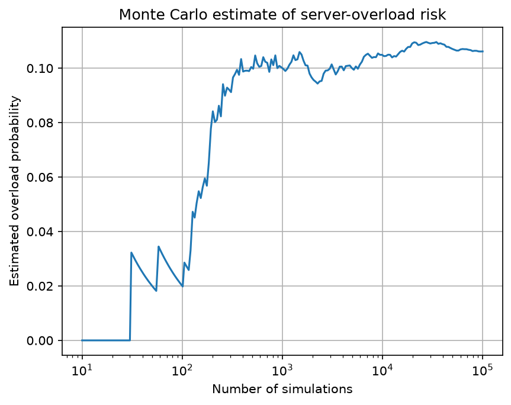
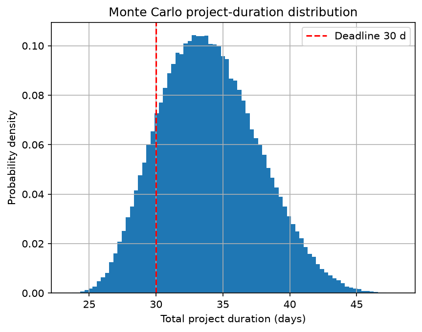

# Task 20 – Random Numbers and Monte Carlo Methods

Programs: [`code/Task_20_monte_carlo.py`](../code/Task_20_monte_carlo.py) · [`extensions/Task_20_ext_project_risk.py`](../extensions/Task_20_ext_project_risk.py)

## B. Inputs and mathematical operations

| Item | Value |
|---|---|
| Inputs | server capacity 1000 requests; demand ~ Normal(mean 850, std 120); N = 100,000 simulations; random seed 42 |
| Operations | draw N random demands; mark each as overloaded if demand > capacity; **probability ≈ (number overloaded)/N**; running estimate = cumulative sum / number of trials |

## C. Changing an input

**Number of simulations N** (exact value from the normal distribution: 10.565 %):

| N | Estimate | Error |
|---|---|---|
| 100 | 2.000 % | 8.57 % |
| 1,000 | 10.100 % | 0.47 % |
| 100,000 | 10.616 % | 0.05 % |
| 1,000,000 | 10.570 % | 0.005 % |

**Capacity / spread:** capacity 1100 → 1.9 % overload; std 80 instead of 120 → 3.1 % (with capacity 1000, std 120 → 10.6 %).

**Explanation:** Monte Carlo error shrinks like 1/√N – 100 times more simulations give only 10 times less error. Raising capacity or reducing uncertainty in demand lowers the overload risk sharply.

## D. Meaning of the output and graph

```
Estimated overload probability: 10.6160%
Number of overload cases: 10616 out of 100000
```

In about 10.6 % of the simulated scenarios the demand is above capacity, so the server is expected to be overloaded roughly once in every ten busy periods. This agrees with the exact normal-distribution value (10.57 %) to within 0.05 %.



The x-axis (log scale) is the number of simulations and the y-axis the running estimate. At the start the curve jumps wildly (few samples), then settles near 0.106 as N grows – the **law of large numbers**. The flat part on the right shows that 100,000 simulations are more than enough for this accuracy.

## E. Different real-world case – project completion risk

* **Assumptions:** a software project has three sequential stages whose durations are uncertain and described by triangular distributions (min, most likely, max) in days: Design (6, 8, 14), Development (12, 15, 25), Testing (4, 6, 12). Stages are independent. The deadline is 30 days. 200,000 simulations, seed 2024.
* **Output:**
  ```
  expected total 34.0 d (sum of most likely = 29 d), std 3.7 d
  P(finish within 30 days) = 14.1%
  80th percentile = 37.1 d; 95th = 40.4 d
  a deadline of 39 days gives ~90% confidence
  ```
* **Interpretation:** adding the "most likely" durations suggests 29 days, but the real expected duration is 34 days because each task's distribution is skewed to the long side (delays are more likely than early finishes). The probability of meeting the 30-day deadline is only about 14 %. A deadline of about 39 days would give a 90 % chance of success. Monte Carlo shows risks that a single-number plan hides.


